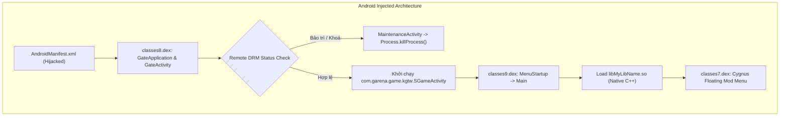
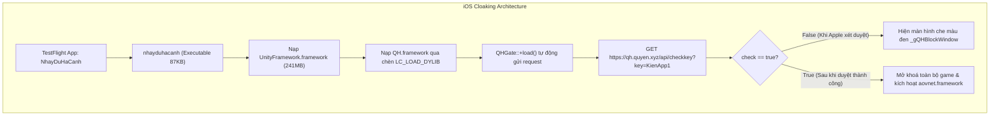

# CHEAT-DECOMPOSITION-AOV

## BÁO CÁO DỊCH NGƯỢC CHUYÊN SÂU: PHÂN TÍCH CÁC MODULE BỊ CAN THIỆP (AOV MOD CLIENT)

Tài liệu kỹ thuật tổng hợp toàn bộ kết quả phân tích mã độc / kỹ thuật dịch ngược (Reverse Engineering) đối với hai biến thể can thiệp trò chơi Liên Quân Mobile (Arena of Valor - AOV) trên nền tảng **Android (APK)** và **iOS / macOS (Apple TestFlight)**.

---

## 1. BẢNG ĐẶC TẢ HỒ SƠ PHÁP Y (FORENSIC METADATA)

| Đối Tượng | Phiên Bản | Kích Thước | SHA256 Checksum |
| :--- | :--- | :--- | :--- |
| **Android APK** (`AndroidV4Fix.apk`) | 1.64.1.7 (V4 Fix) | 243,469,118 bytes | `267c3434e2e949bdeda863604793885a222303e5aa8c876b08d8ce8e3e5416d8` |
| **iOS Launcher** (`nhayduhacanh`) | 1.0 (Build 3) | 87,712 bytes | `834cb886f823ed1efec8f39d3e407451242e45f23f331a69646c5dfaa26436fe` |
| **iOS DRM Framework** (`QH`) | 1.0 | 90,496 bytes | `456f8bc647eb4f57e28ece5402ee5d2232812dea4875f5da3fc661b12ee8c2e8` |
| **iOS Cheat Engine** (`aovnet`) | 1.0 | 51,514,240 bytes | `78dda168b1d1ecfe5cbd7353bea9123c07941eb2e5224e32722ae233882cf609` |

> [!NOTE]
> Do kích thước hai tệp cài đặt đầy đủ vượt quá giới hạn 100 MB của GitHub (`AndroidV4Fix.apk` ~243 MB và `nhayduhacanh.app` ~483 MB chứa dữ liệu game có bản quyền của bên thứ ba), kho lưu trữ này chứa toàn bộ mã nguồn dịch ngược (Decompiled Source Code), cấu hình Manifest, tập lệnh phân rã nhị phân (Disassembly) và bảng ký hiệu (Symbol Tables).

---

## 2. PHÂN TÍCH CHI TIẾT BIẾN THỂ ANDROID (`AndroidV4Fix.apk`)

### 2.1. Cấu Trúc Khác Biệt Tổng Quan
Bản game chính thức từ Google Play Store bao gồm `classes.dex` đến `classes6.dex` cùng các thư viện native tiêu chuẩn. Kẻ làm mod đã can thiệp:
1. Sửa đổi `AndroidManifest.xml` (Đổi package, chiếm quyền Application và Activity khởi động).
2. Tiêm thêm 3 tệp DEX: `classes7.dex`, `classes8.dex`, `classes9.dex`.
3. Chèn thư viện native độc hại: `lib/arm64-v8a/libMyLibName.so`.



---

### 2.2. Phân Tích Từng Module Đã Bị Sửa Đổi / Tiêm Mới

#### A. Cấu Hình Khởi Động (`AndroidManifest.xml`)
- **Tệp gốc**: `package="com.garena.game.kgvn"`, nạp `NGameApplication`, Activity khởi chạy là `SGameActivity`.
- **Bản sửa đổi**:
  - `package="com.garena.game.kgvn1"`: Thêm ký tự `1` để cho phép thiết bị cài song song với Liên Quân gốc mà không phát sinh lỗi trùng package ID.
  - `<application android:name="com.android.support.auth.GateApplication">`: Can thiệp sớm nhất vào chu trình khởi động của Android Runtime.
  - `<activity android:name="com.android.support.auth.GateActivity">`: Đặt làm màn hình Launcher Activity đón nhận `android.intent.action.MAIN`.

#### B. Module Cổng Kiểm Soát Bản Quyền (`classes8.dex`)
- **`com.android.support.auth.GateApplication`**: Kiểm tra `/proc/self/cmdline` để phân biệt tiến trình. Nếu tiến trình có đuôi `:apkGate`, ứng dụng sẽ chỉ chạy giao diện kiểm tra máy chủ mà không nạp Unity Engine nhằm tiết kiệm tài nguyên.
- **`com.android.support.auth.GateActivity`**: Hiển thị màn hình chờ với thông điệp *"MAP SÁNG ANDROID V3"*, kiểm tra trạng thái máy chủ trước khi cho phép người dùng vào game.
- **`com.android.support.auth.RemoteGate`**:
  - Endpoint: `https://hackgame.lienquan.io.vn/apk-manager/status.php`
  - Gửi yêu cầu kiểm tra ngầm định kỳ mỗi 3 giây:
    ```text
    code=<owner_code>&app_id=map-sang-v4-20261103-r2&package=com.garena.game.kgvo&phienban=11
    ```
  - Nếu trường `enabled` là `false`, ứng dụng lập tức khởi tạo `MaintenanceActivity`, đóng toàn bộ tiến trình con và gọi `System.exit(0)`.

#### C. Cầu Nối Nạp Native Engine (`classes9.dex`)
- **`com.android.support.Main`**:
  - Khởi tạo thư viện can thiệp nhị phân: `System.loadLibrary("MyLibName")`.
  - Khai báo các hàm native động: `CheckOverlayPermission()`, `GetRuntimeStatusNative()`, `PrepareRuntimeNative()`, `SetAuthorized()`.
- **`com.android.support.auth.MenuStartup`**:
  - Đăng ký `ActivityLifecycleCallbacks` trên toàn bộ ứng dụng. Khi `SGameActivity` chuyển sang trạng thái `Resumed` và xác thực bản quyền thành công (`IsAuthorized() == true`), module sẽ gắn giao diện menu nổi vào cửa sổ game.

#### D. Bộ Giao Diện Menu & Tiện Ích Can Thiệp (`classes7.dex`)
- **Hệ thống giao diện nổi (`ThemesData/CYGNUS`, `ThemesData/DZ`, `ThemesData/LGL`)**: Xây dựng Floating Window Overlay cho phép bật/tắt các tính năng can thiệp.
- **`com.android.support.GameAccountLogout`**:
  - Cơ chế xoá dữ liệu xác thực: Truy cập trực tiếp vào thư mục dữ liệu:
    ```text
    /data/data/com.garena.game.kgvn1/shared_prefs/com.garena.msdk.token_cache.xml
    ```
  - Xoá sạch tệp token và `token_cache.xml.bak`, sau đó dùng `AlarmManager` lên lịch khởi động lại game sau 400ms. Cho phép người dùng chuyển nhanh tài khoản smurf khi vừa bị cấm (banned).
- **`com.android.support.ComplaintUi`**: Lắng nghe gói tin cảnh báo tố cáo theo thời gian thực từ tầng native để hiển thị hộp thoại cảnh báo người chơi.
- **`com.android.support.SoundCloudMusicService`**: Chạy Background Service kết hợp `MediaSession` và `WakeLock` để phát nhạc SoundCloud ngầm trong khi chơi game.

#### E. Thư Viện Gian Lận C++ (`lib/arm64-v8a/libMyLibName.so`)
- **Công nghệ Hooking**: Tích hợp **Dobby Hook** (`DobbyHook`).
- **Mô-đun Anti-Anti-Cheat (`[V4_ANTI]`)**:
  - Đọc và phân tích bản đồ bộ nhớ từ `/proc/self/maps`.
  - Thực hiện kiểm tra tính toàn vẹn (BTI check, ELF Build-ID validation).
  - Can thiệp và vô hiệu hoá cơ chế giám sát của hệ thống chống hack chính thức `libanort.so` (Tencent ACE / Anti-Cheat Expert).
- **Hook Đồ Họa & Vẽ ESP**: Hook hàm `eglSwapBuffers` của EGL/OpenGL để vẽ trực tiếp khung chữ nhật, tia nhắm và thanh máu lên bề mặt render của game.
- **Các tính năng game được giải mã**:
  - `1_Toggle_Hack Map`: Xoá sương mù bản đồ (Fog of War).
  - `2_SeekBar_Cam Xa_0_30`: Can thiệp `get_SupportedBoth60FPS_CameraHeight` để thay đổi góc nhìn camera (Drone View).
  - `101_Toggle_Kích Hoạt Aim Game`: Tự động găm chiêu thức vào tướng địch yếu máu nhất hoặc gần nhất.
  - `120_Toggle_Mua Bán Đồ Nhanh`: Tự động bán Giáp Hồi Sinh khi đã mất mạng và lập tức mua Liềm Đoạt Mệnh / Quả Cầu Băng Sương trong vài mili-giây.

---

## 3. PHÂN TÍCH CHI TIẾT BIẾN THỂ IOS / TESTFLIGHT (`Map Có Menu.app`)

### 3.1. Kỹ Thuật Ngụy Trang Qua Mặt Kiểm Duyệt TestFlight (Cloaking & Review Bypass)

Để phân phối được bản hack Liên Quân trên hệ thống **Apple TestFlight chính thức**, nhóm phát triển sử dụng chiến thuật ngụy trang 3 lớp:



---

### 3.2. Phân Tích Từng Module Đã Bị Sửa Đổi / Tiêm Mới

#### A. Cấu Hình Ngụy Trang (`Info.plist`)
- `CFBundleIdentifier = com.cong.nhayduhacanh`
- `CFBundleName = nhayduhacanh`: Khai báo với Apple đây là ứng dụng mô phỏng nhảy dù thể thao nhằm qua mặt hệ thống kiểm duyệt tự động.
- `CFBundleDisplayName = Map Có Menu`: Tên hiển thị thật ra ngoài màn hình người dùng.

#### B. Khung DRM Kiểm Soát Bản Quyền (`Frameworks/QH.framework`)
- **Tệp nhị phân**: `QH` (Mach-O 64-bit dynamic library, dung lượng 90 KB).
- **Lớp khởi tạo**: `QHGate`.
  - Khai thác hàm khởi tạo Objective-C `+[QHGate load]` để tự động thực thi ngay khi dynamic linker (`dyld`) nạp framework vào bộ nhớ, trước cả hàm `main` của game.
  - Đọc khoá bản quyền `QHKey = KienApp1` từ `QH.framework/Info.plist`.
  - Gửi truy vấn HTTP:
    ```text
    GET https://qh.quyen.xyz/api/checkkey?key=KienApp1
    ```
  - **Kết quả thực nghiệm**: Máy chủ trả về `{"check":true}`. Nếu chuyển thành `false`, phương thức `blockWithMessage:` sẽ khởi tạo một `UIWindow` màu đen đè lên toàn bộ màn hình (`UIWindowLevelAlert`) để khoá ứng dụng.

#### C. Thư Viện Nhị Phân Bị Biến Đổi Sâu (`Frameworks/aovnet.framework`)
Đây là module nguy hiểm nhất trên biến thể iOS. Trong bản game chuẩn của Garena, `aovnet.framework` là thư viện thuần mạng kết nối máy chủ trò chơi. Tuy nhiên, ở bản mod này:
1. **Liên kết bất thường với thư viện đồ họa Metal**: Tệp nhị phân bị liên kết thêm `Metal.framework`, `MetalKit.framework`, `GLKit.framework`, `QuartzCore.framework`.
2. **Nhúng Dear ImGui Renderer**: Tận dụng MetalKit để dựng menu nổi điều khiển hack đè trực tiếp lên khung hình của game engine Unity.
3. **Engine Hooking bằng Breakpoint phần cứng ARM64**:
   - Xuất hiện các hàm: `_hook`, `_hook_one_point`, `_unhook`.
   - Sử dụng lệnh hệ thống `sysctlbyname("hw.optional.breakpoint")` kết hợp `mach_task_self_` để thao tác trực tiếp trên các thanh ghi phần cứng (Hardware Breakpoints). Kỹ thuật này giúp qua mặt cơ chế bảo vệ phân quyền bộ nhớ (W^X / Code Signing Hardening) của hệ điều hành iOS.
4. **Các module gian lận tích hợp**:
   - `AimbotEnable`, `ManualAim`, `AimbotNew`: Tự động ngắm chiêu thức.
   - `unlockskin`, `skinid2`: Mở khoá trang phục.
   - Quản lý đổi đồ nhanh cho 11 món trang bị sinh tồn.
   - Bắt gói tin tố cáo và xuất nhật ký thời gian thực vào:
     ```text
     ~/Library/Containers/com.cong.nhayduhacanh/Data/Documents/CheckToCao-status.txt
     ```
     *(Nội dung trích xuất: `"Lua đã chạy; vào trận để lấy danh sách người chơi"`)*.

#### D. Can Thiệp Header Mach-O (`Frameworks/UnityFramework.framework`)
Kẻ tấn công đã sử dụng công cụ tiêm dylib để can thiệp vào bảng `Load Commands` của `UnityFramework`:
```text
Load Command 75:
    cmd LC_LOAD_DYLIB
    cmdsize 48
    name @rpath/QH.framework/QH (offset 24)
```
Việc đặt `@rpath/QH.framework/QH` làm lệnh tải cuối cùng buộc hệ điều hành iOS phải tự động nạp `QH.framework` mỗi khi game khởi động.

---

## 4. BẢNG SO SÁNH ĐỐI CHIẾU KIẾN TRÚC CAN THIỆP

| Tiêu Chí | Biến Thể Android (`AndroidV4Fix.apk`) | Biến Thể iOS TestFlight (`nhayduhacanh`) |
| :--- | :--- | :--- |
| **Kênh cài đặt** | Sideload tệp APK thủ công | Link mời công khai qua Apple TestFlight |
| **Cơ chế ngụy trang** | Thêm hậu tố package (`.kgvn1`) | Đổi tên thành ứng dụng Nhảy Dù (`nhayduhacanh`) |
| **Vị trí tiêm cổng DRM** | Java DEX (`classes8.dex` - `RemoteGate`) | Dynamic Framework (`QH.framework` - `QHGate`) |
| **Máy chủ DRM** | `https://hackgame.lienquan.io.vn` | `https://qh.quyen.xyz` (Key: `KienApp1`) |
| **Thư viện thực thi Cheat** | Nạp ngoài: `libMyLibName.so` (1.6 MB) | Biến đổi thư viện gốc: `aovnet.framework` (51 MB) |
| **Công nghệ dựng giao diện** | Android WindowManager Floating Service | MetalKit + Dear ImGui Overlay |
| **Công nghệ Hooking** | Dobby Hook C++ | Dobby Hook + ARM64 Hardware Breakpoints |
| **Hệ thống tính năng** | Map Hack, Cam Xa, Aimbot, Auto Swap Đồ, Mod Skin, Check Tố Cáo | **Hoàn toàn đồng nhất với bản Android** |

---

## 5. CẤU TRÚC THƯ MỤC TRONG REPOSITORY

```text
aov-reverse-engineering/
├── README.md                                  # Báo cáo kỹ thuật chi tiết
├── .gitignore                                 # Loại trừ tệp nhị phân > 100MB
├── android/
│   ├── manifest/
│   │   └── AndroidManifest.xml                # Tệp cấu hình Android đã giải mã
│   ├── src/
│   │   ├── Main.java                          # Cầu nối JNI nạp Native Lib
│   │   ├── Menu.java                          # Giao diện menu chính
│   │   ├── GameAccountLogout.java             # Bộ xoá token Garena MSDK
│   │   ├── ComplaintUi.java                   # Bộ bắt sự kiện tố cáo
│   │   ├── SoundCloudMusicService.java        # Dịch vụ phát nhạc SoundCloud
│   │   ├── auth_gate/                         # Toàn bộ mã nguồn DRM & Gate
│   │   └── ThemesData/                        # Các bộ theme giao diện mod (Cygnus, DZ, LGL)
│   └── native_analysis/
│       ├── libMyLibName_strings.txt           # Trích xuất toàn bộ chuỗi từ libMyLibName.so
│       └── libMyLibName_symbols.txt           # Bảng ký hiệu nhị phân
└── ios_testflight/
    ├── manifest/
    │   └── Info.plist                         # Tệp cấu hình ngụy trang TestFlight
    └── frameworks/
        ├── QH/
        │   ├── Info.plist                     # Cấu hình chứa QHKey = KienApp1
        │   ├── QH_strings.txt                 # Chuỗi trích xuất từ QH.framework
        │   ├── QH_symbols.txt                 # Bảng ký hiệu của QHGate
        │   └── QH_disassembly.asm             # Tập lệnh phân rã nhị phân QH
        └── aovnet/
            ├── aovnet_linked_libs.txt         # Bằng chứng liên kết Metal/MetalKit
            ├── aovnet_cheat_strings.txt       # Chuỗi nhận diện Aimbot, Mod Skin, ImGui
            └── aovnet_hook_symbols.txt        # Các hàm can thiệp phần cứng (_hook)
```

---

## 6. KHUYẾN CÁO BẢO MẬT & PHÁP LÝ

1. **Rủi ro khoá tài khoản**: Mọi hành vi can thiệp bộ nhớ và gói tin đều vi phạm Điều khoản dịch vụ của Garena / Tencent. Các cơ chế như `[V4_ANTI]` hoặc `CheckToCao` chỉ trì hoãn chứ không thể ngăn chặn hoàn toàn việc phát hiện từ phía máy chủ (Server-side telemetry).
2. **Rủi ro dữ liệu cá nhân**: Bản mod gửi dữ liệu định danh thiết bị (`android_id`, model máy, phiên bản) về các máy chủ không xác thực (`hackgame.lienquan.io.vn` và `qh.quyen.xyz`).
3. **Mục đích tài liệu**: Tài liệu này được biên soạn phục vụ mục đích nghiên cứu bảo mật, phân tích mã độc và pháp y số (Digital Forensics / Blue Team analysis).
